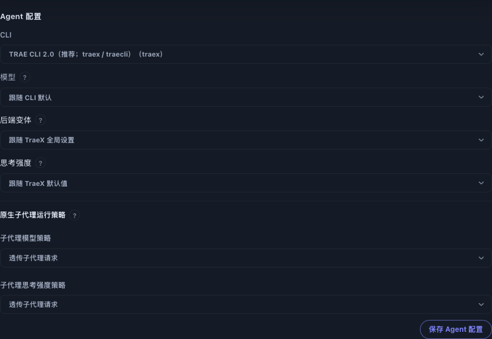
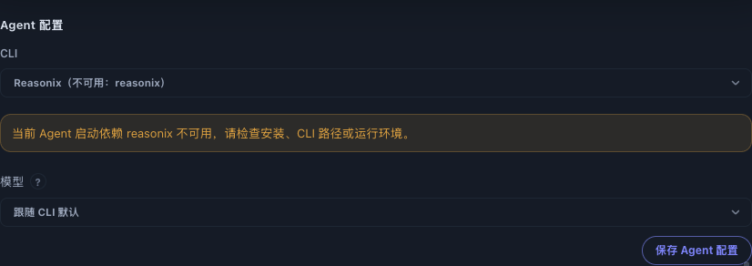

# Dashboard 的 CLI 可用性检测

Dashboard 或后台服务的 PATH 可能不包含 CLI 安装目录，而用户的 `.zprofile`、`.zshrc` 或 `.bashrc` 可以找到该 CLI。选项列表只检查服务进程 PATH 时，查不到并不代表未安装。

选项列表保持快速、无 Shell 的检查。`availabilityStatus` 区分 `available`、`unknown` 与 `unavailable`：快速检查失败时返回 `unknown`，Forge 尚未运行 doctor 时也返回 `unknown`。原有 `available` 字段保留以兼容旧客户端。

Bot 配置、添加 Bot 和 Agent 编辑表单异步请求 `/api/cli-options/availability?key=<选择键>`。Bot 配置页附带 `bot=<appId>`，服务端仅在已保存的启动身份与请求选择键一致时应用该 Bot 的运行时、可执行文件路径和环境。网关检测实际 wrapper 命令；Forge 检测 TraeX、Forge 和 doctor。

完整检测使用与 Worker 相同的登录/交互 Shell 顺序、字面 argv 查询和 macOS Codex 应用回退。Shell 检测不会阻塞 Dashboard 事件循环，每个子进程受超时和输出上限约束。超时或异常 Shell 返回 `unknown`，不会显示“不可用”结论；HTTP 失败也不改写为 CLI 缺失。切换选择、更新 Bot 配置或卸载表单会取消旧请求，旧结果不能覆盖当前选择。该接口沿用管理权限门禁。

以下截图来自隔离的 Dashboard 和真实 Chrome 操作。服务 PATH 不含安装目录，TraeX 仅通过 Zsh rc 中的 PATH 可达；选择真正缺失的 Reasonix 后才出现警告。

这是显示与探测层的修复，不改变 Worker 启动方式、模型切换或会话恢复逻辑。
